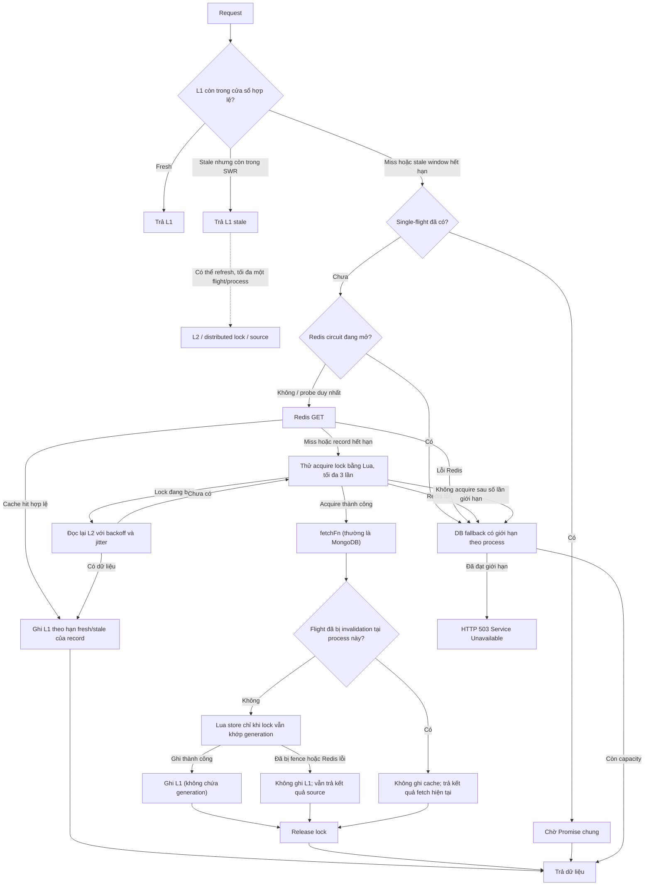
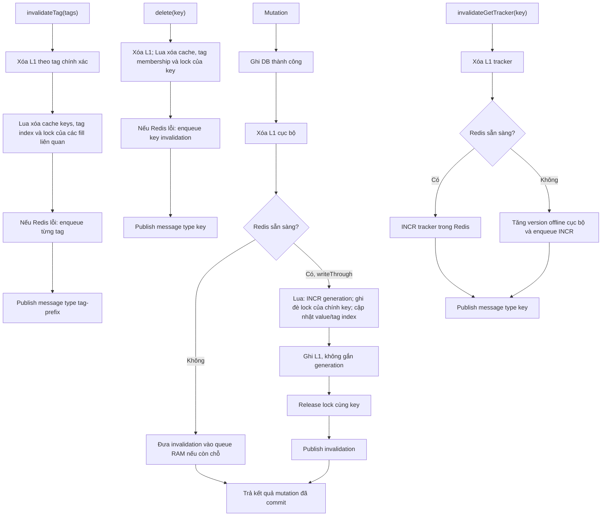

# Kiến trúc CacheService

Tài liệu này mô tả luồng đang có trong `Backend/src/modules/cache/cache.service.ts`, các giả định vận hành và giới hạn nhất quán. Đây là mô tả implementation hiện tại, không phải cam kết rằng Redis hoặc cache luôn sẵn sàng.

## 1. Tổng quan

- **L1:** `Map` trong RAM của từng tiến trình Node.js; có LRU, giới hạn số entry/kích thước và TTL ngắn. L1 không chia sẻ giữa các instance và không lưu generation của fencing.
- **L2:** Redis dùng chung giữa các instance, lưu payload, metadata SWR, tag index, tracker và fill lock.
- **Nguồn dữ liệu:** `fetchFn` thường truy vấn MongoDB qua Prisma.
- **Single-flight:** gộp các lần tải cùng key bên trong một process.
- **Distributed fill lock + fencing:** hạn chế nhiều instance cùng nạp một key và ngăn một fill cũ ghi đè khi Redis đã thu hồi/thay lock.
- **Redis circuit breaker + bounded DB fallback:** khi Redis lỗi, đọc có thể truy vấn nguồn dữ liệu trực tiếp trong giới hạn từng process. Khi giới hạn đầy, request nhận HTTP 503.

## 2. Luồng đọc

### Bounded fallback

Giới hạn đọc fallback lấy từ `CACHE_DB_FALLBACK_MAX_CONCURRENT`, mặc định **50 request đồng thời trên mỗi process**. Đây là một giá trị cấu hình, không phải khoảng cho phép “30–50”. Nếu có N process, tổng số fallback đồng thời có thể xấp xỉ N × cấu hình; cần tính cùng connection pool và năng lực MongoDB.

Fallback không ghi L1/L2 vì khi Redis mất kết nối, cache có thể không được invalidation đúng hạn. Nếu capacity của process đã đầy, code ném `ServiceUnavailableException` (HTTP 503), không trả kết quả giả hoặc tự chờ vô hạn.

## 3. Ghi và invalidation

### Phạm vi từng thao tác

- **`writeThrough`:** gọi `dbAction` trước. Sau khi DB thành công, Lua tăng bộ đếm generation, ghi đè lock của **chính cache key đang được ghi** bằng generation mới, rồi cập nhật cache và tag index. Nó không quét hay thu hồi lock của tất cả key khác cùng tag. L1 nhận value/tags/TTL, không nhận generation.
- **`delete(key)`:** Lua xóa cache key, reverse tag index, membership trong tag set và lock của key. Đây là **xóa lock**, khác với write-through ghi đè lock bằng generation mới.
- **`invalidateTag(tags)`:** xóa L1 theo tag chính xác; Redis Lua xóa các cache key thuộc tag và lock của các tagged fill đang chạy. Tag được so sánh chính xác, không dùng prefix rộng như `tag:user` khớp `tag:user2`.
- **`invalidateGetTracker(key)`:** tăng tracker Redis bằng `INCR`, không lưu tracker trong L1. Khi Redis lỗi, dùng version offline theo process và xếp một lệnh `INCR` để retry.

Mutation DB đã commit không bị báo thất bại chỉ vì Redis gặp lỗi: thao tác cache được đưa vào queue best-effort và hàm trả kết quả DB. Nếu queue đầy hoặc process dừng trước khi retry, invalidation chưa xử lý có thể mất; xem phần giới hạn.

## 4. Fencing và cache fill

Khi một process acquire fill lock, Lua tăng `cache:fill-generation:v1` và lưu giá trị đó làm lock token. Generation được giữ ở Redis; **L1 không lưu generation**.

Trước khi ghi cache, Lua so sánh token của fill với lock hiện tại:

- Nếu lock vẫn mang token của fill, write được chấp nhận.
- Nếu `delete` hoặc `invalidateTag` đã xóa lock, write bị từ chối.
- Nếu `writeThrough` đã thay lock bằng generation mới cho cùng key, write cũ bị từ chối.

Cờ `flight.invalidated` là bảo vệ phụ trong process hiện tại. Quyết định cuối cùng cho việc ghi Redis nằm trong Lua, nên không phụ thuộc riêng vào việc instance có nhận Pub/Sub hay không. Fencing ngăn stale fill ghi cache **khi Redis giữ được tính đơn điệu của counter**; không nên mô tả là bảo đảm tuyệt đối nếu counter có thể bị mất hoặc lùi.

## 5. L1/L2 SWR và negative cache

### Stale-while-revalidate

- **L1:** mặc định TTL tối đa 5 giây (có thể cấu hình). Nếu call site bật SWR, L1 có thể trả stale trong cửa sổ stale còn lại và khởi chạy refresh nền. L1 được giới hạn dung lượng, nên entry có thể bị LRU loại trước TTL.
- **L2:** record SWR chứa payload, `freshUntil`, `staleUntil`; Redis TTL kéo dài tới hết stale window. L2 stale vẫn có thể được trả trong cửa sổ cho phép đồng thời kích hoạt một refresh nền qua distributed lock. SWR được opt-in tại call site và bị giới hạn tối đa 5 phút.
- Nếu Redis circuit đang mở, refresh nền có thể đi vào DB fallback; kết quả fallback không được cache. Vì vậy SWR không loại bỏ tải DB khi Redis đang lỗi.

### Negative cache

`getOrSetWithTag` có thể cache kết quả `null` bằng record negative riêng, với TTL ngắn được truyền vào call site. Ví dụ cache set không tồn tại dùng `SET_NOT_FOUND_CACHE_TTL_SECONDS`, mặc định 30 giây. Mục đích là giảm cache penetration; giá trị này phải ngắn để một tài nguyên vừa được tạo không bị che bởi negative entry lâu.

## 6. Redis outage và hàng đợi retry

### Đọc khi Redis lỗi

Lỗi Redis mở circuit trong khoảng `CACHE_REDIS_FAILURE_BACKOFF_MS` (mặc định 3 giây). Trong thời gian circuit mở, cache read bỏ qua Redis và gọi DB qua bounded fallback. Sau cooldown chỉ một request được thử Redis; các request khác tiếp tục fallback. Lệnh Redis có timeout cấu hình qua `REDIS_COMMAND_TIMEOUT_MS` (mặc định 3 giây trong cấu hình node-redis hiện tại). Nếu thay client hoặc nâng phiên bản thư viện, cần xác minh lại API timeout tương ứng.

Nếu Redis cache write lỗi sau khi DB fetch thành công, hàm trả dữ liệu vừa fetch thay vì biến lỗi cache thành HTTP 500. Lỗi vẫn được ghi log có giới hạn tần suất.

### Pending invalidation queue

- Queue nằm trong RAM của từng process, tối đa 10.000 entry; key/tag/tracker được gom theo định danh để tránh trùng.
- Thử lại từ 1 giây, tăng backoff theo cấp số nhân tới tối đa 30 giây.
- Khi flush thành công, entry chỉ bị xóa nếu map vẫn chứa **đúng object invalidation đã xử lý**. Entry mới hơn cùng ID không bị xóa nhầm.
- Queue không bền: restart process làm mất entry. Khi đầy, entry mới không được thêm và log cảnh báo; cần durable outbox nếu nghiệp vụ không chấp nhận mất invalidation.
- Khi Redis phục hồi, một tracker có thể vẫn trả version Redis cũ cho tới khi lệnh `INCR` đang chờ được flush. Do backoff tối đa 30 giây, cache key của version cũ có thể được đọc lại trong cửa sổ đó. Version offline trong RAM là theo process, không phải bộ đếm phân tán.

## 7. Pub/Sub invalidation giữa các instance

Publisher gửi JSON trên channel `cache:l1:invalidate:v1`, kèm `source: INSTANCE_ID` (PID cộng UUID). Subscriber kiểm tra cấu trúc message, bỏ qua message do chính process gửi, rồi xử lý:

- `key`: xóa entry L1 và đánh dấu flight liên quan bị invalidated.
- `tag-prefix`: tên wire giữ tương thích, nhưng các writer hiện tại gửi **tag key chính xác**; subscriber xóa đúng tag đó.
- `keys-batch`: xóa tối đa 500 key L1 trong một message.

Publisher xử lý lỗi Pub/Sub theo kiểu best-effort và không làm mutation DB đã commit thất bại. Nếu message bị mất, L1 ở instance khác có thể giữ dữ liệu cũ cho tới khi hết hạn fresh/stale tương ứng. Redis Pub/Sub không phải durable queue.

## 8. CacheMaintenanceService

`CacheMaintenanceService.deletePatternForMaintenance(pattern)` là công cụ maintenance, không dành cho request path. Nó dùng `SCAN` theo batch, xóa qua Lua và phát message `keys-batch` theo tối đa 500 key mỗi lần. Hàm bỏ qua generation key và các fill-lock key nội bộ; xóa cache key sẽ để Lua thu hồi lock tương ứng. Không dùng pattern scan thường xuyên trên keyspace lớn.

## 9. Giới hạn và điều kiện vận hành

1. **Redis Cluster chưa được hỗ trợ.** Không chỉ các key ghép từ ARGV: ngay cả các key được truyền trong KEYS của Lua cũng có thể nằm ở hash slot khác nhau. Các script hiện tại truy cập nhiều key logic, một số key còn được dựng từ prefix trong ARGV. Chạy Standalone hoặc Sentinel; muốn dùng Cluster phải thiết kế lại key với hash tag chung và khai báo đầy đủ mọi key script truy cập trong KEYS.
2. **Bảo vệ cả generation lẫn tracker khỏi eviction.** `cache:fill-generation:v1` và tracker được tạo bởi `getTracker` không có TTL. Chính sách `volatile-*` không evict key không TTL; `noeviction` cũng tránh eviction nhưng khi hết memory, lệnh ghi có thể lỗi. Tránh `allkeys-*` nếu tính đúng của tracker/fencing phụ thuộc các key này.
3. **Persistence/failover có thể làm counter lùi.** AOF với `appendfsync everysec` có thể mất khoảng một giây ghi gần nhất khi có sự cố (thời gian thực tế tùy kiểu lỗi); Sentinel dùng replication bất đồng bộ và có thể promote replica chưa nhận hết các lệnh `INCR`. Khi Redis phục hồi từ trạng thái cũ, generation có thể bị cấp lại. Vì vậy fencing đúng với giả định Redis giữ counter đơn điệu; AOF/RDB và topology giảm rủi ro nhưng không tạo cam kết “không bao giờ mất”.
4. **Fallback chỉ giới hạn theo process.** Mức tối đa toàn hệ thống phụ thuộc số instance và cấu hình từng instance; đây không phải global admission control.
5. **Invalidation không durable.** Pending queue nằm trong RAM và Pub/Sub không lưu message. Nếu cả hai cơ chế không giao được invalidation, dữ liệu cũ có thể còn trong L1 tới hết stale window đã cấu hình; cần outbox/durable queue nếu yêu cầu nhất quán mạnh hơn.
6. **Request đang chạy vẫn có thể nhận kết quả cũ.** Invalidation fence việc ghi cache, nhưng không hủy query DB đã chạy và không thay đổi response đã được tạo cho request đó.

## 10. Kết luận

CacheService cung cấp L1/L2, single-flight, distributed fill lock, fencing, SWR, negative cache và fail-open có giới hạn cho luồng đọc. Tính đúng đắn của fencing phụ thuộc Redis giữ được generation; invalidation giữa các instance là best-effort qua Pub/Sub và retry queue trong RAM. Mức dữ liệu cũ tối đa không phải một con số chung: nó phụ thuộc TTL/stale window, thời gian Redis outage, trạng thái queue và việc process có bị restart hay không. Các giới hạn này cần được tính vào SLO và quyết định có cần durable invalidation/outbox hay không.
