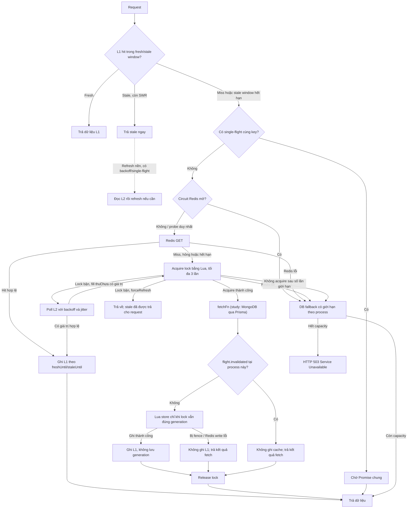
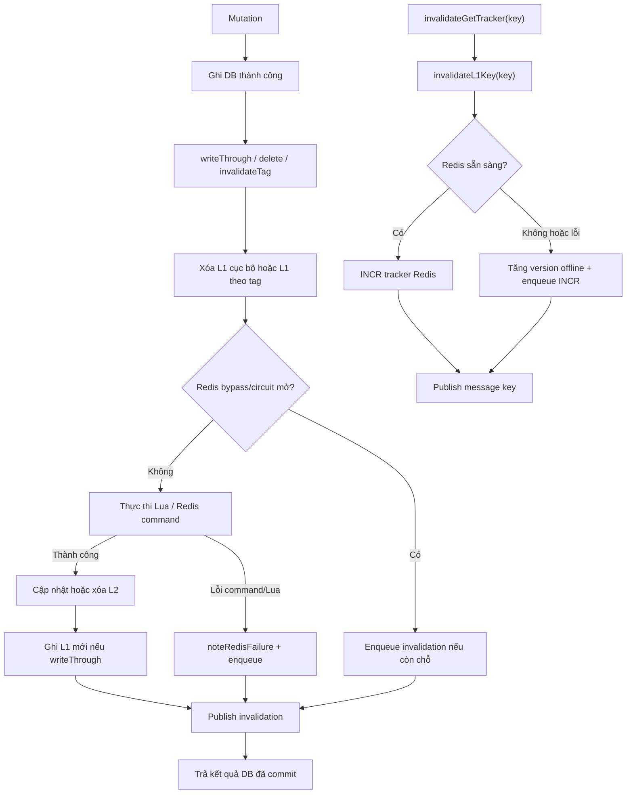

# Kiến trúc CacheService

Tài liệu này hợp nhất mô tả kiến trúc và luồng vận hành của CacheService, đồng thời đối chiếu với implementation trong `Backend/src/modules/cache/cache.service.ts`, cấu hình Redis và các call site liên quan. Đây là mô tả hành vi hiện tại cùng các giới hạn đã xác nhận, không phải cam kết Redis/cache luôn sẵn sàng.

## 1. Tổng quan

| Thành phần | Vai trò |
| --- | --- |
| **L1** | `Map` trong RAM của từng process Node.js, có LRU, giới hạn dung lượng và TTL ngắn. Không chia sẻ giữa các instance và **không lưu generation** của fencing. |
| **L2 (Redis)** | Dùng chung giữa các instance; lưu payload, SWR metadata, tag index, tracker và fill lock. |
| **Nguồn dữ liệu** | `fetchFn`; ở luồng study hiện tại là MongoDB thông qua Prisma. |
| **Single-flight** | Gộp tải cùng cache key trong một process thành một Promise. Không thay distributed lock giữa các process. |
| **Distributed fill lock + fencing** | Hạn chế nhiều instance cùng nạp một key và ngăn fill cũ ghi cache nếu lock đã bị xóa/thay thế/hết hạn. |
| **Circuit breaker + bounded DB fallback** | Khi Redis lỗi, đọc có thể đi thẳng xuống nguồn dữ liệu với giới hạn từng process; quá tải trả HTTP 503. |
| **Pub/Sub** | Thông báo best-effort để instance khác xóa L1. |
| **Pending invalidation queue** | Giữ invalidation cần retry trong RAM khi Redis lỗi; queue không durable. |

### Các giá trị mặc định đáng chú ý

| Cấu hình | Mặc định | Phạm vi |
| --- | ---: | --- |
| L1 TTL tối đa | 5 giây | Mỗi process |
| L1 capacity | 1.000 entry, 32 MiB | Mỗi process |
| L1 SWR retry backoff | 1 giây | Mỗi entry |
| Cache fill lock TTL | 10 giây | Redis |
| Thời gian chờ lock | Lock TTL + 500 ms | Mỗi lần chờ |
| Số lần thử acquire lock | 3 | Mỗi cache fill |
| Redis circuit backoff | 3 giây | Mỗi process |
| DB fallback đồng thời | 50 | Mỗi process |
| Pending invalidation queue | 10.000 entry | Mỗi process |
| Retry invalidation | 1–30 giây, exponential backoff | Mỗi process |
| SWR tối đa | 5 phút | Mỗi cache record |
| Invalidation batch | 500 key | Mỗi message Pub/Sub |
| Redis command timeout | 3 giây | Theo cấu hình client hiện tại |

Các giá trị có thể cấu hình qua env gồm `L1_CACHE_TTL_MS`, `L1_CACHE_MAX_ENTRIES`, `L1_CACHE_MAX_BYTES`, `L1_CACHE_SWR_RETRY_BACKOFF_MS`, `CACHE_LOCK_TTL_MS`, `CACHE_LOCK_WAIT_MS`, `CACHE_REDIS_FAILURE_BACKOFF_MS`, `CACHE_DB_FALLBACK_MAX_CONCURRENT` và `REDIS_COMMAND_TIMEOUT_MS`. Số lần thử lock, giới hạn SWR, kích thước queue và backoff retry hiện là hằng số trong code.

## 2. Luồng đọc

### Các bước quan trọng

1. **L1:** fresh thì trả ngay. Stale nhưng còn trong cửa sổ SWR thì trả stale; khi hết backoff, khởi chạy refresh nền. Miss hoặc stale window hết hạn mới vào luồng tải đồng bộ.
2. **Single-flight:** chỉ gộp các request cùng key trong một process. Nhiều instance vẫn cần distributed lock.
3. **Circuit breaker:** khi đang mở, cache read bỏ qua Redis. Sau cooldown chỉ một request probe; request khác dùng bounded fallback.
4. **L2 Redis GET:** lỗi chuyển sang DB fallback; hit hợp lệ được ghi L1. Nếu record L2 stale và SWR được bật, trả stale và bắt đầu refresh nền.
5. **Distributed lock:** fill thường chờ/poll L2 khi lock đang bận; nếu owner nhả lock mà chưa có cache thì waiter thử acquire lại. Hết số lần thử thì đi DB fallback có giới hạn.
6. **Source fetch và store:** owner gọi `fetchFn`; Lua chỉ cho ghi Redis nếu token lock còn khớp. L1 chỉ được ghi khi Redis xác nhận store thành công và flight chưa bị invalidated.
7. **Release:** owner nhả lock bằng Lua so sánh token trong `finally`; lock mới của process khác không bị owner cũ xóa nhầm.

### Refresh nền `forceRefresh`

L2 SWR đã xác nhận cache stale nên refresh nền bỏ qua lần GET L2 và thử lấy lock. Nếu một instance khác đang refresh, `forceRefresh` trả về ngay: stale đã được phục vụ, nên nó không chờ lock và không gọi source. Nếu Redis gặp lỗi, code đi bounded fallback; kết quả fallback không được cache. Nếu refresh source trả kết quả không cache được (ví dụ resource đã bị xóa), code thử xóa entry L2 cũ và publish invalidation.

### Bounded DB fallback

Giới hạn lấy từ `CACHE_DB_FALLBACK_MAX_CONCURRENT`, mặc định **50 request đồng thời trên mỗi process**. Đây là một giá trị cấu hình, không phải khoảng “30–50”. Với N process, tổng fallback có thể xấp xỉ N × cấu hình; cần tính cùng connection pool và năng lực MongoDB.

Fallback không ghi L1/L2 vì invalidation có thể không lan truyền đúng hạn khi Redis lỗi. Nếu capacity của process đã đầy, code ném `ServiceUnavailableException` (HTTP 503), không chờ vô hạn. Đây chỉ là giới hạn per-process, không phải admission control toàn cụm.

## 3. Luồng ghi và invalidation

Mutation DB được thực hiện trước. Nếu DB đã commit, lỗi cache/Redis không được biến thành lỗi mutation; code trả kết quả DB, đồng thời enqueue invalidation khi cần. Queue đầy hoặc process restart vẫn có thể làm mất invalidation.

### Phạm vi từng thao tác

- **`writeThrough(key, dbAction, ttl, tags)`:** sau DB commit, gọi `invalidateL1Key(key)`. Lua tăng generation, ghi đè lock của **chính key đang ghi**, cập nhật cache value và tag index. Thành công thì ghi L1 (value/tags/TTL, không có generation) rồi release lock. Nếu circuit đang mở hoặc eval/Redis command lỗi thì enqueue key invalidation. Lỗi trong khối này cũng bao gồm lỗi serialize `JSON.stringify(result)`, xem mục 9.
- **`delete(key)`:** gọi `invalidateL1Key(key)`, rồi Lua xóa cache key, reverse tag index, membership trong tag sets và lock của key. Nếu Redis bypass/lỗi thì enqueue key invalidation. Hàm vẫn publish message kiểu `key`; trong đường lỗi/bypass, kết quả xóa trả về 0.
- **`invalidateTag(tags)`:** xóa L1 theo tag chính xác. Lua tìm cache keys, gỡ membership và reverse index, xóa cache entries, lock của các fill liên quan. Script đọc sorted set v2 và set legacy để hỗ trợ migration. Nếu Redis bypass/lỗi thì enqueue từng tag; sau đó publish message `tag-prefix`.
- **`invalidateGetTracker(key)`:** gọi `invalidateL1Key(key)` để xóa entry/flight cùng key nếu có; tracker bản thân **không được lưu trong L1**. Nếu Redis sẵn sàng thì `INCR` và trả version mới; nếu circuit mở hoặc command lỗi thì tăng version offline theo process, enqueue lệnh `INCR` và hàm trả `undefined`. Cả hai nhánh đều thử publish message `key`, nhưng subscriber thường không có tracker L1 nào để xóa.

Tên wire `tag-prefix` được giữ để tương thích; writer hiện tại gửi tag key chính xác, không dùng prefix rộng. Ví dụ tag `tag:user` không khớp `tag:user2`.

## 4. Fencing, tracker và lock TTL

### Fencing cache fill

Khi acquire lock, Lua tăng counter Redis `cache:fill-generation:v1` và lưu generation làm lock token. Với fill có tag, script đăng ký fill trong tag-fill registry để `invalidateTag` tìm được lock liên quan. Generation **chỉ nằm ở Redis**, không nằm trong L1.

Store Lua so sánh token fill với lock hiện tại. Ghi bị từ chối nếu:

- `delete` hoặc `invalidateTag` đã **xóa** lock;
- `writeThrough` đã **ghi đè lock của cùng key** bằng generation khác;
- lock đã **hết TTL** trước khi source fetch hoàn tất; mặc định `CACHE_LOCK_TTL_MS` là 10 giây.

Khi lock hết TTL, fill cũ không làm sai cache vì Redis từ chối ghi, nhưng truy vấn DB vừa chạy bị lãng phí và kết quả đó không được cache. Lock có thể được instance khác acquire sau khi hết hạn.

Cờ `flight.invalidated` chỉ là bảo vệ phụ trong process. Quyết định cuối cùng cho việc ghi Redis nằm trong Lua. Fencing bảo vệ được với điều kiện Redis giữ bộ đếm đơn điệu; không phải bảo đảm tuyệt đối nếu generation bị mất hoặc lùi.

### Tracker version

`getTracker` dùng Lua GET-or-create trên Redis để khởi tạo version là `1` mà không có race GET/SET. Mỗi lần gọi đọc Redis trực tiếp: tracker không nằm trong L1 và không có single-flight, đổi lại thấy được INCR của instance khác nhưng tốn một Redis round-trip. Khi circuit mở hoặc Redis lỗi, nó dùng `Date.now()`/version cục bộ theo process.

Nếu offline `INCR` đang chờ mà Redis phục hồi, `getTracker` có thể đọc lại version Redis cũ trước khi queue flush. Khi đó cache key của version cũ có thể được dùng lại. Retry queue có thể backoff tới 30 giây; đây là lý do không nên xem version offline là counter phân tán.

## 5. L1/L2 SWR và negative cache

### Stale-while-revalidate

- **L1:** TTL mặc định tối đa 5 giây, có thể cấu hình. Nếu call site bật SWR, entry stale vẫn được trả trong stale window; refresh bị giới hạn bởi `L1_CACHE_SWR_RETRY_BACKOFF_MS` (mặc định 1 giây) và single-flight. LRU có thể loại entry trước TTL.
- **L2:** record chứa payload, `freshUntil`, `staleUntil`; Redis TTL kéo dài tới hết stale window. Record stale được trả nếu SWR đã bật, đồng thời bắt đầu một refresh nền qua distributed lock. SWR tối đa 5 phút.
- Khi Redis circuit mở, refresh nền có thể gọi DB fallback; kết quả fallback không cache. Vì vậy SWR không phải DB shield khi Redis unavailable.

### Negative cache

`getOrSetWithTag` chỉ cache `null` khi call site truyền `negativeCacheTtlSeconds > 0`. Nó lưu negative record riêng với TTL ngắn để giảm cache penetration. Trong luồng study, `getSetById` dùng `SET_NOT_FOUND_CACHE_TTL_SECONDS`, mặc định 30 giây. Đây là cấu hình tại `study.service.ts`, không phải mặc định chung của CacheService.

## 6. Redis outage, timeout và retry queue

### Redis circuit và timeout

Lỗi Redis mở circuit trong `CACHE_REDIS_FAILURE_BACKOFF_MS` (mặc định 3 giây). Khi circuit mở, read dùng bounded fallback. Sau cooldown, một request probe; success đóng circuit, reject mở lại và nhả cờ probe.

Repo hiện dùng package `redis@5.11.0`. `src/utils/redis.ts` truyền `REDIS_COMMAND_TIMEOUT_MS` (mặc định 3 giây) vào default command options. Type và command queue của phiên bản đang cài có timeout theo milliseconds và áp timeout bằng abort signal, khiến lệnh timeout reject; do đó catch hiện có thể nhả probe. Đây là xác nhận theo dependency/code tại workspace, không thay thế kiểm thử network blackhole trong môi trường triển khai.

### Pending invalidation queue

- Queue nằm trong RAM của mỗi process, tối đa 10.000 entry; key/tag/tracker được gộp theo loại và giá trị.
- Retry bắt đầu 1 giây, nhân đôi sau mỗi lần flush thất bại, tối đa 30 giây.
- Khi flush thành công, entry chỉ bị xóa nếu Map vẫn chứa **đúng object đã xử lý**; entry mới hơn cùng ID không bị xóa nhầm.
- Queue không durable: restart làm mất entry. Nếu queue đầy, entry mới không được thêm và code log cảnh báo.
- Pub/Sub publish là best-effort. Một publish thất bại sau khi Redis invalidation thành công không làm mutation fail và không tạo durable retry riêng cho message Pub/Sub.

## 7. Pub/Sub giữa các instance

Publisher gửi JSON tới `cache:l1:invalidate:v1`, kèm `source: INSTANCE_ID` (PID cộng UUID). Subscriber validate message, bỏ qua message do chính process gửi vì process đó đã tự invalidation, sau đó xử lý:

| Message | Hành vi phía nhận |
| --- | --- |
| `key` | Gọi `invalidateL1Key`: xóa entry L1 và đánh dấu flight liên quan invalidated nếu có. |
| `tag-prefix` | Wire name tương thích; giá trị hiện tại là tag chính xác, subscriber xóa đúng tag ở L1. |
| `keys-batch` | Invalidate tối đa 500 key L1 trong một message. |

Message tracker cũng mang kiểu `key`, nhưng tracker không được cache ở L1; message đó không xóa những entry cache có version trong tên key. Khi tracker đổi, caller dùng version mới để tạo cache key mới.

Nếu message bị mất, instance khác có thể phục vụ dữ liệu cũ tới hết fresh/stale window của L1. Redis Pub/Sub không durable.

## 8. CacheMaintenanceService

`CacheMaintenanceService.deletePatternForMaintenance(pattern)` dành cho job bảo trì, không dùng trong request path. Hàm quét `TYPE: string` bằng `SCAN`, xóa theo batch tối đa 500 key qua Lua và publish `keys-batch`. Hiện code chỉ bỏ qua generation key và các fill-lock key nội bộ.

**Tracker cũng là Redis string không TTL nhưng hiện không bị loại khỏi maintenance scan.** Pattern rộng có thể xóa tracker; lần gọi sau tạo lại version `1`, khiến cache còn sót của version `1` có thể được đọc lại. Caller cần tránh pattern khớp tracker. Tương tự, không gọi `delete(key)` trực tiếp với tracker key trừ khi chủ động chấp nhận reset version.

## 9. Giới hạn và điều kiện vận hành

1. **Redis Cluster chưa được hỗ trợ.** Không chỉ key ghép từ `ARGV`: các key truyền trong `KEYS` của Lua (cache, index, lock, tag) cũng có thể ở hash slot khác nhau và gây `CROSSSLOT`. Muốn dùng Cluster cần thiết kế lại key với hash tag chung và khai báo đầy đủ mọi key script truy cập trong `KEYS`. Hiện dùng Standalone hoặc Sentinel.
2. **Bảo vệ generation và tracker khỏi eviction.** `cache:fill-generation:v1` và tracker không TTL. `volatile-*` không evict key không TTL; `noeviction` cũng tránh eviction nhưng khi Redis chạm `maxmemory`, lệnh ghi có thể bị từ chối. Các catch path xử lý lỗi Redis gọi `noteRedisFailure`, mở circuit; các lần đọc tiếp theo rơi xuống DB fallback và khi quá giới hạn trả 503. Cần cảnh báo dung lượng trước khi chạm `maxmemory`. Tránh `allkeys-*` nếu cần giữ monotonic generation/tracker.
3. **Persistence/failover có thể làm counter lùi.** AOF `appendfsync everysec` có thể mất khoảng một giây ghi gần nhất khi sự cố; Sentinel replication bất đồng bộ có thể promote replica chưa nhận hết INCR. Generation khi đó có thể bị cấp lại. Persistence/topology giảm rủi ro nhưng không bảo đảm không mất.
4. **Fallback chỉ giới hạn từng process.** Tổng tải DB có thể xấp xỉ số process nhân giới hạn, không phải global admission control.
5. **Queue và Pub/Sub không durable.** Queue mất khi process restart hoặc quá đầy; Pub/Sub message có thể mất. Nếu yêu cầu invalidation không được mất, cần durable outbox/queue. Khi invalidation không tới nơi, dữ liệu cũ tồn tại đến khi hết TTL/stale window hoặc queue xử lý được.
6. **Request đang chạy vẫn có thể nhận kết quả fetch cũ.** Fencing ngăn ghi cache nếu lock không còn hợp lệ, nhưng không hủy query đã chạy và không thay đổi response đã tạo cho caller.
7. **Payload/serialization có thể bị nhầm thành lỗi Redis ở một số nhánh.** Decode khi xử lý giá trị lấy từ waiter nằm trong try/catch gọi `noteRedisFailure`; `JSON.stringify(result)` trong `writeThrough` cũng nằm trong try/catch đó. Các lỗi này có thể mở circuit dù nguyên nhân không phải Redis. Ngược lại, decode sau GET Redis ban đầu và encode trong cache fill không nằm trong cùng Redis-command catch; lỗi có thể reject flight/request mà không mở circuit. Nên thu hẹp try/catch và phân loại lỗi nếu cần tránh false-positive.
8. **SWR refresh trong thời gian Redis lỗi vẫn tiêu thụ DB.** Refresh nền có thể đi bounded fallback, không cache được kết quả; stale được phục vụ tới hết cửa sổ đã cấu hình. Theo dõi fallback concurrency và p95/p99 trong outage.

## 10. Kết luận

CacheService hiện có L1/L2, single-flight, distributed fill lock, fencing, SWR, negative cache, Pub/Sub và fail-open có giới hạn cho luồng đọc. Tính đúng của fencing phụ thuộc Redis giữ generation; tracker phụ thuộc không bị reset/evict ngoài chủ ý; invalidation liên instance vẫn best-effort qua Pub/Sub và queue trong RAM.

Không có một con số duy nhất cho độ cũ tối đa trong mọi sự cố: nó phụ thuộc TTL/stale window, thời gian Redis outage, trạng thái retry queue, tracker có bị reset hay không và process có restart không. Các giả định này cần được đưa vào SLO; nếu không chấp nhận mất invalidation, cần durable mechanism thay vì chỉ dựa vào Pub/Sub và RAM queue.
